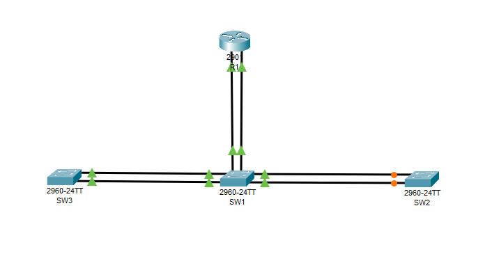
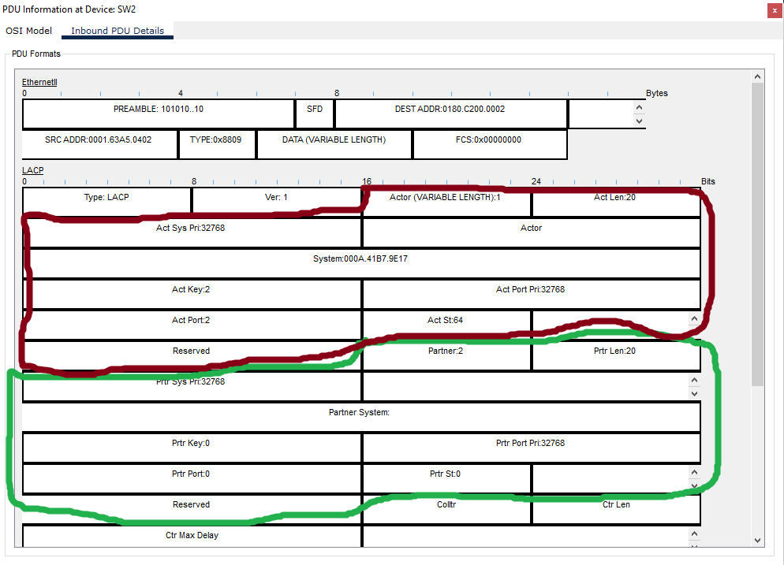

# Отчёт по лабораторной работе 1.5
**Тема:** LAG  
**Выполнили:** Малыгин Андрей, Кислов Илья, гр. 539

## Топология  

## Ответы на вопросы

1. **Изучите собранную топологию. Часть интерфейсов между коммутаторами в нерабочем состоянии. Почему?**  

Некоторые интерфейсы были отключены протоколом STP во избежание петель.

2. **Приведите вывод команд show etherchannel summary, show etherchannel port-channel и show interfaces Po1 на SW1.**  
```
SW1#sh etherchannel summary 

Number of channel-groups in use: 1
Number of aggregators:           1

Group  Port-channel  Protocol    Ports
------+-------------+-----------+----------------------------------------------

1      Po1(SU)           -      Gig0/1(P) Gig0/2(P) 

SW1#sh etherchannel port-channel 
                Channel-group listing:
                ----------------------

Group: 1
----------
                Port-channels in the group:
                ---------------------------

Port-channel: Po1
------------

Age of the Port-channel   = 00d:00h:00m:51s
Logical slot/port   = 2/1       Number of ports = 2
GC                  = 0x00000000      HotStandBy port = null
Port state          = Port-channel 
Protocol            =   PAGP
Port Security       = Disabled

Ports in the Port-channel:

Index   Load   Port     EC state        No of bits
------+------+------+------------------+-----------
  0     00     Gig0/1   On                 0
  0     00     Gig0/2   On                 0
Time since last port bundled:    00d:00h:00m:25s    Gig0/2

SW1#sh interfaces Po1
Port-channel1 is up, line protocol is up (connected)
  Hardware is EtherChannel, address is 0030.a3d7.ed24 (bia 0030.a3d7.ed24)
  MTU 1500 bytes, BW 2000000 Kbit, DLY 1000 usec,
     reliability 255/255, txload 1/255, rxload 1/255
  Encapsulation ARPA, loopback not set
  Keepalive set (10 sec)
  Half-duplex, 2000Mb/s
  input flow-control is off, output flow-control is off
  Members in this channel: Gig0/1 ,Gig0/2 ,
  ARP type: ARPA, ARP Timeout 04:00:00
  Last input 00:00:08, output 00:00:05, output hang never
  Last clearing of "show interface" counters never
  Input queue: 0/75/0/0 (size/max/drops/flushes); Total output drops: 0
  Queueing strategy: fifo
  Output queue :0/40 (size/max)
  5 minute input rate 0 bits/sec, 0 packets/sec
  5 minute output rate 0 bits/sec, 0 packets/sec
     956 packets input, 193351 bytes, 0 no buffer
     Received 956 broadcasts, 0 runts, 0 giants, 0 throttles
     0 input errors, 0 CRC, 0 frame, 0 overrun, 0 ignored, 0 abort
     0 watchdog, 0 multicast, 0 pause input
     0 input packets with dribble condition detected
     2357 packets output, 263570 bytes, 0 underruns
     0 output errors, 0 collisions, 10 interface resets
     0 babbles, 0 late collision, 0 deferred
     0 lost carrier, 0 no carrier
     0 output buffer failures, 0 output buffers swapped out
```
**В каком состоянии находится агрегированный канал и дочерние интерфейсы? Готов ли он передавать трафик? Может ли это вызвать проблемы, с учетом того, что ответная сторона ещё не настроена?**  
Агрегированный канал работает ( Po1(SU) ), дочерние интерфейсы находятся во включённом состоянии работы в агрегированном канале (EC state: On).  
Port-channel1 is up, line protocol is up (connected); Po1(SU); Gig0/1(P) Gig0/2(P) - канал готов передавать трафик, логический порт в состоянии In use, физические порты включены в агрегацию (флаг P)  
Если начать передачу трафика прямо сейчас, то есть риск образования петель, т.к. R1 воспринимает эти порты как два отдельных. 
  
3. **Приведите вывод команд show etherchannel summary, show etherchannel port-channel и show interfaces Po2 на SW1.**  
```
SW1#sh etherchannel sum

Number of channel-groups in use: 2
Number of aggregators:           2

Group  Port-channel  Protocol    Ports
------+-------------+-----------+----------------------------------------------

1      Po1(SU)           -      Gig0/1(P) Gig0/2(P) 
2      Po2(SD)           LACP   Fa0/1(I) Fa0/2(I) 

SW1#sh etherchannel port-channel 
                Channel-group listing:
                ----------------------

Group: 1
----------
                Port-channels in the group:
                ---------------------------

Port-channel: Po1
------------

Age of the Port-channel   = 00d:00h:38m:23s
Logical slot/port   = 2/1       Number of ports = 2
GC                  = 0x00000000      HotStandBy port = null
Port state          = Port-channel 
Protocol            =   PAGP
Port Security       = Disabled

Ports in the Port-channel:

Index   Load   Port     EC state        No of bits
------+------+------+------------------+-----------
  0     00     Gig0/1   On                 0
  0     00     Gig0/2   On                 0
Time since last port bundled:    00d:00h:37m:57s    Gig0/2
Group: 2
----------
                Port-channels in the group:
                ---------------------------

Port-channel: Po2    (Primary Aggregator)
------------

Age of the Port-channel   = 00d:00h:01m:06s
Logical slot/port   = 2/2       Number of ports = 0
GC                  = 0x00000000      HotStandBy port = null
Port state          = Port-channel 
Protocol            =   LACP
Port Security       = Disabled

SW1#sh int po2
Port-channel2 is down, line protocol is down (disabled)
  Hardware is EtherChannel, address is 0003.e4a8.46a7 (bia 0003.e4a8.46a7)
  MTU 1500 bytes, BW 200000 Kbit, DLY 1000 usec,
     reliability 255/255, txload 1/255, rxload 1/255
  Encapsulation ARPA, loopback not set
  Keepalive set (10 sec)
  Half-duplex, 200Mb/s
  input flow-control is off, output flow-control is off
  Members in this channel: Fa0/1 ,Fa0/2 ,
  ARP type: ARPA, ARP Timeout 04:00:00
  Last input 00:00:08, output 00:00:05, output hang never
  Last clearing of "show interface" counters never
  Input queue: 0/75/0/0 (size/max/drops/flushes); Total output drops: 0
  Queueing strategy: fifo
  Output queue :0/40 (size/max)
  5 minute input rate 0 bits/sec, 0 packets/sec
  5 minute output rate 0 bits/sec, 0 packets/sec
     956 packets input, 193351 bytes, 0 no buffer
     Received 956 broadcasts, 0 runts, 0 giants, 0 throttles
     0 input errors, 0 CRC, 0 frame, 0 overrun, 0 ignored, 0 abort
     0 watchdog, 0 multicast, 0 pause input
     0 input packets with dribble condition detected
     2357 packets output, 263570 bytes, 0 underruns
     0 output errors, 0 collisions, 10 interface resets
     0 babbles, 0 late collision, 0 deferred
     0 lost carrier, 0 no carrier
     0 output buffer failures, 0 output buffers swapped out
```  
**В каком состоянии находится агрегированный канал и дочерние интерфейсы? Готов ли он передавать трафик?**  
Агрегированный канал выключен, а дочерние интерфейсы не включены в агрегацию (флаг I), соответственно передача трафика невозможна.  
  
4. **Изучите сообщения протокола LACP. Перейдите в режим симуляции, очистите фильтры, оставив только протокол LACP. Пролистайте события до тех пор, пока SW1 не отправит LACPDU. Изучите LACPDU (Outbound или Inbound PDU Details). Приведите скриншот содержимого. Обведите на нём разными цветами информацию, которая относится к собственной системе (Actor) и партнёрской (Partner). Почему информация о партнёре пустая (нули)?**  
  
Информация о партнёре пустая, потому что на SW2 не настроен агрегированный канал.
  
5. **Обратите внимание на то, что номера LAG на SW1 и SW2 отличаются. Это помешает успешно согласовать агрегированный канал или нет?**  

Разные LAG-номера не помешают согласовать канал, т.к. согласование идёт по SSID.  
**Приведите вывод команды show etherchannel port-channel на SW2.**

```
SW2#sh etherchannel port-channel 
                Channel-group listing:
                ----------------------

Group: 1
----------
                Port-channels in the group:
                ---------------------------

Port-channel: Po1    (Primary Aggregator)
------------

Age of the Port-channel   = 00d:00h:02m:42s
Logical slot/port   = 2/1       Number of ports = 2
GC                  = 0x00000000      HotStandBy port = null
Port state          = Port-channel 
Protocol            =   LACP
Port Security       = Disabled

Ports in the Port-channel:

Index   Load   Port     EC state        No of bits
------+------+------+------------------+-----------
  0     00     Fa0/1    Passive            0
  0     00     Fa0/2    Passive            0
Time since last port bundled:    00d:00h:02m:29s    Fa0/2
```  

6. **Приведите вывод команд show etherchannel summary и show etherchannel port-channel на SW1.**
```
SW1#sh etherchannel sum

Number of channel-groups in use: 3
Number of aggregators:           3

Group  Port-channel  Protocol    Ports
------+-------------+-----------+----------------------------------------------

1      Po1(SU)           -      Gig0/1(P) Gig0/2(P) 
2      Po2(SU)           LACP   Fa0/1(P) Fa0/2(P) 
3      Po3(SU)           PAgP   Fa0/3(P) Fa0/4(P) 
SW1#sh eth port
                Channel-group listing:
                ----------------------

Group: 1
----------
                Port-channels in the group:
                ---------------------------

Port-channel: Po1
------------

Age of the Port-channel   = 00d:01h:05m:39s
Logical slot/port   = 2/1       Number of ports = 2
GC                  = 0x00000000      HotStandBy port = null
Port state          = Port-channel 
Protocol            =   PAGP
Port Security       = Disabled

Ports in the Port-channel:

Index   Load   Port     EC state        No of bits
------+------+------+------------------+-----------
  0     00     Gig0/1   On                 0
  0     00     Gig0/2   On                 0
Time since last port bundled:    00d:01h:05m:13s    Gig0/2
Group: 2
----------
                Port-channels in the group:
                ---------------------------

Port-channel: Po2    (Primary Aggregator)
------------

Age of the Port-channel   = 00d:00h:28m:22s
Logical slot/port   = 2/2       Number of ports = 2
GC                  = 0x00000000      HotStandBy port = null
Port state          = Port-channel 
Protocol            =   LACP
Port Security       = Disabled

Ports in the Port-channel:

Index   Load   Port     EC state        No of bits
------+------+------+------------------+-----------
  0     00     Fa0/1    Active             0
  0     00     Fa0/2    Active             0
Time since last port bundled:    00d:00h:09m:47s    Fa0/2
Group: 3
----------
                Port-channels in the group:
                ---------------------------

Port-channel: Po3
------------

Age of the Port-channel   = 00d:00h:02m:08s
Logical slot/port   = 2/3       Number of ports = 2
GC                  = 0x00000000      HotStandBy port = null
Port state          = Port-channel 
Protocol            =   PAGP
Port Security       = Disabled

Ports in the Port-channel:

Index   Load   Port     EC state        No of bits
------+------+------+------------------+-----------
  0     00     Fa0/3    Desirable-Sl       0
  0     00     Fa0/4    Desirable-Sl       0
Time since last port bundled:    00d:00h:01m:25s    Fa0/4
```  

7. **Просмотрите текущую конфигурацию на коммутаторе SW1 командой show running-config. Приведите часть конфигурации, которая относится к интерфейсам Fa0/1, Fa0/2 и Port-channel2.**  

```
SW1#sh r
interface Port-channel2
!
interface FastEthernet0/1
 channel-group 2 mode active
!
interface FastEthernet0/2
 channel-group 2 mode active
!
```  

8. **Просмотрите текущую конфигурацию на коммутаторе SW1 командой show running-config. Приведите часть конфигурации, которая относится к интерфейсам Fa0/1, Fa0/2 и Port-channel2. Сравните с предыдущим результатом.**  

```
SW1#sh r
interface Port-channel2
 switchport mode trunk
 switchport nonegotiate
 spanning-tree portfast trunk
!
interface FastEthernet0/1
 switchport mode trunk
 switchport nonegotiate
 channel-group 2 mode active
!
interface FastEthernet0/2
 switchport mode trunk
 switchport nonegotiate
 channel-group 2 mode active
!
```
Интерфейсы перешли в режим магистральных портов.  

9. **Какой способ вычисления хеша для балансировки трафика используется сейчас на SW1? Используйте команду show etherchannel load-balance, чтобы посмотреть.**  

```
SW1#sh etherchannel load-balance 
EtherChannel Load-Balancing Operational State (src-mac):
Non-IP: Source MAC address
  IPv4: Source MAC address
  IPv6: Source MAC address
```
Балансировка хэша по MAC-адресу источника.

**Если большая часть трафика в сети будет идти в направлении от R1, какая проблема может возникнуть?**  
Весь трафик будет идти по одному порту из-за одинакового хэша, поскольку MAC-адрес источника одинаковый для каждого кадра.  
  
10. **Какой алгоритм вы выбрали? Почему? Используйте команду show etherchannel load-balance, чтобы проверить себя.**  
```
SW1#sh etherchannel load-balance 
EtherChannel Load-Balancing Operational State (src-dst-ip):
Non-IP: Source XOR Destination MAC address
  IPv4: Source XOR Destination IP address
  IPv6: Source XOR Destination IP address
```
Почему `src-dst-ip` лучший алгоритм:
- `src-mac` как уже разобрали выше не подходит;
- `dst-mac` работает от R1, но в обратную сторону (т.е. к R1) трафик пойдёт по одному линку;
- `src-dst-mac` R1 подключён к интернету, а за SW2 находится ПК, который качает файлы с разных сайтов. Тогда src-mac - адрес ПК, а dst-mac адрес R1, трафик идёт по одному линку;
- `src-ip` если за SW2 стоит сервер, раздающий данные хостам через R1, то также один линк;
- `dst-ip` если за SW2 множество хостов, обращающихся к одному серверу за R1, то один линк;
- `src-dst-ip` универсальный вариант, работающий и для скачивания файлов с разных сайтов (разный dst-ip), и для скачивания хостами файлов с одного сервера (разный src-ip), и для прочего трафика через R1 и наоборот. 