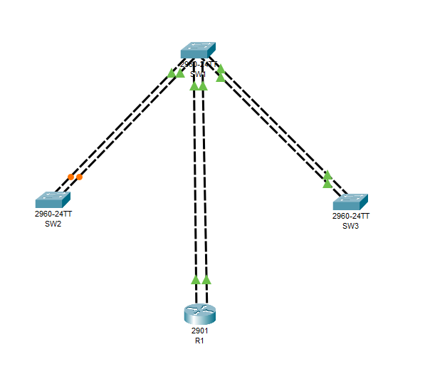
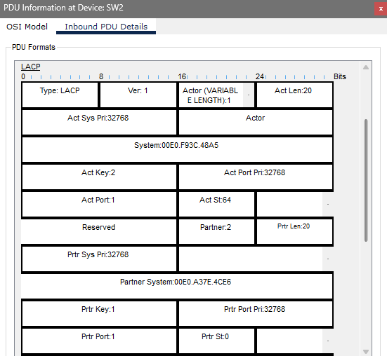
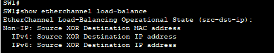
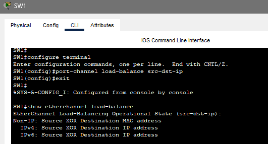

# Отчет по лабораторной работе 5
**Тема:** LAG / EtherChannel  
**Выполнил:** Пьянов Никита 439 группа  
**Специальность:** 09.02.06 «Сетевое и системное администрирование»  

---

## Топология

---

## Часть 1: Создание топологии и начальная конфигурация устройств

Собрана топология согласно заданию. На всех устройствах выполнена базовая настройка: задан hostname, отключен поиск DNS (`no ip domain-lookup`), включена синхронизация вывода на консоли (`logging synchronous`).

### 📌 Вопрос 1
**Изучите собранную топологию. Часть интерфейсов между коммутаторами в нерабочем состоянии. Почему?**
**Ответ:** Интерфейсы находятся в нерабочем состоянии (оранжевый цвет), потому что протокол **STP** обнаружил петли в топологии. Чтобы избежать широковещательного шторма, STP логически блокирует избыточные порты. Между SW1 и SW2, а также между SW1 и SW3 проложено по два параллельных канала.

---

## Часть 2: Настройка статической агрегации

### 📌 Вопрос 2
**Приведите вывод команд `show etherchannel summary`, `show etherchannel port-channel` и `show interfaces Po1` на SW1.**
*(Вставь скриншоты из Части 2)*

**В каком состоянии находится агрегированный канал и дочерние интерфейсы?**
**Ответ:** Агрегированный канал `Po1` находится в состоянии **SU** (Switched, Up/in use). Дочерние физические интерфейсы `Gi0/1` и `Gi0/2` находятся в состоянии **P** (bundled).

**Готов ли он передавать трафик?**
**Ответ:** Да, канал готов к передаче трафика (`line protocol is up`).

**Может ли это вызвать проблемы, с учетом того, что ответная сторона ещё не настроена?**
**Ответ:** Да, режим `on` (статическая агрегация) не использует протоколы согласования. SW1 принудительно поднимает канал локально, даже если на другой стороне настройки не совпадают. Это может привести к «черной дыре» или петле.

---

## Часть 3: Настройка динамического LAG по протоколу LACP

### 📌 Вопрос 3
**Приведите вывод команд `show etherchannel summary`, `show etherchannel port-channel` и `show interfaces Po2` на SW1.**
*(Вставь скриншоты из Части 3)*

**В каком состоянии находится агрегированный канал и дочерние интерфейсы? Готов ли он передавать трафик?**
**Ответ:** Агрегированный канал `Po2` находится в состоянии **SD** (Switched, Down). Дочерние интерфейсы `Fa0/1` и `Fa0/2` находятся в состоянии **I** (Independent — не включены в канал). Канал **не готов** передавать трафик, так как протокол LACP не получил ответ от партнера.

### 📌 Вопрос 4
**Изучите LACPDU. Приведите скриншот содержимого. Обведите на нём разными цветами информацию, которая относится к собственной системе (Actor) и партнёрской (Partner). Почему информация о партнёре пустая (нули)?**

**Ответ:** Информация о партнере (Partner) пустая (заполнена нулями), потому что на момент отправки пакета коммутатор SW2 еще не был настроен для работы с LACP. SW1 отправляет свои данные (Actor) и ждет ответа от соседа для согласования параметров.

### 📌 Вопрос 5
**Обратите внимание на то, что номера LAG на SW1 и SW2 отличаются. Это помешает успешно согласовать агрегированный канал или нет?**
**Ответ:** Нет, это не помешает. Номер LAG (channel-group) является **локальным** идентификатором для каждого устройства. Протокол LACP идентифицирует партнера по его System ID (приоритет + MAC-адрес). Поэтому номера могут отличаться (на SW1 — 2, на SW2 — 1), и канал успешно поднимется.

**Приведите вывод команды `show etherchannel port-channel` на SW2.**
*(Вставь скриншот из Части 3)*

---

## Часть 4: Настройка динамического LAG по протоколу PAgP

### 📌 Вопрос 6
**Приведите вывод команд `show etherchannel summary` и `show etherchannel port-channel` на SW1.**
*(Вставь скриншоты из Части 4)*

**Ответ:** В выводе видно, что группа 3 (Port-channel 3) использует протокол **PAgP** и находится в состоянии **SU** (в работе). Физические интерфейсы Fa0/3 и Fa0/4 имеют флаг **P** (bundled). В выводе `show etherchannel port-channel` для группы 3 указано `Protocol = PAgP`. Канал успешно согласован между SW1 (режим `desirable`) и SW3 (режим `auto`).

---

## Часть 5: Конфигурация LAG интерфейса

### 📌 Вопрос 7
**Просмотрите текущую конфигурацию на коммутаторе SW1... Приведите часть конфигурации, которая относится к интерфейсам Fa0/1, Fa0/2 и Port-channel2.**
*(Вставь первый скриншот `show running-config`)*

**Ответ:** В текущей конфигурации на Port-channel2 нет настроек режима порта. Физические интерфейсы Fa0/1 и Fa0/2 имеют только команду `channel-group 2 mode active`.

### 📌 Вопрос 8
**Просмотрите текущую конфигурацию... Сравните с предыдущим результатом.**
*(Вставь второй скриншот `show running-config`)*

**Ответ:** Команды `switchport mode trunk`, `switchport nonegotiate` и `spanning-tree portfast trunk` появились в конфигурации интерфейса `Port-channel2`. На физических портах (например, Fa0/1) настройки транка тоже появились, но это произошло автоматически из-за наследования от логического интерфейса Port-channel2. Настраивать транк отдельно на каждом физическом порту не нужно — достаточно настроить его на Port-channel.

---

## Часть 6: Настройка балансировки

### 📌 Вопрос 9
**Какой способ вычисления хеша для балансировки трафика используется сейчас на SW1?**
**Ответ:** По умолчанию используется алгоритм **`src-mac`** (на основе MAC-адреса источника).

**Если большая часть трафика в сети будет идти в направлении от R1, какая проблема может возникнуть?**
**Ответ:** Возникнет проблема неравномерной балансировки (поляризации). Так как у R1 один MAC-адрес, все пакеты, идущие от него, будут иметь одинаковый хеш, и весь трафик пойдет только по одному физическому линку, а остальные будут простаивать.

### 📌 Вопрос 10
**Какой алгоритм вы выбрали? Почему?**
**Ответ:** Выбран алгоритм **`src-dst-ip`** (по IP-адресу источника и назначения). Он позволяет распределить трафик по всем линкам, так как учитывает IP-адреса. Пакеты от R1 к разным получателям будут иметь разные IP-адреса назначения, поэтому хеш будет различаться, и трафик равномерно распределится по каналам.

---

## Вывод
В ходе лабораторной работы была изучена технология агрегации каналов (LAG/EtherChannel). Настроены статическая агрегация (on) и динамические протоколы согласования LACP и PAgP. Изучен принцип работы LACPDU, наследование настроек логическим интерфейсом Port-channel и алгоритмы балансировки нагрузки. Настроен оптимальный алгоритм балансировки `src-dst-ip` для предотвращения поляризации трафика.