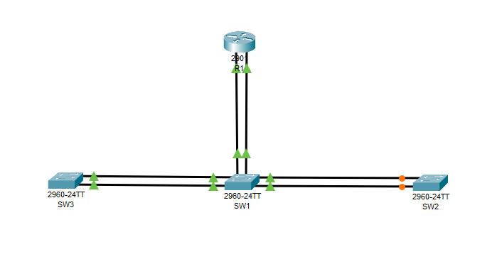
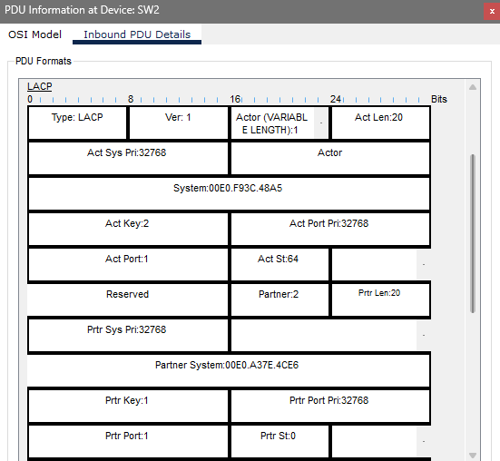

# Отчет по лабораторной работе 5
**Тема:** LAG / EtherChannel  
**Выполнил:** Пьянов Никита 439 группа  
**Специальность:** 09.02.06 «Сетевое и системное администрирование»  

## Топология сети


## Анализ топологии
После сборки сети и базовой настройки устройств я заметил, что часть интерфейсов между коммутаторами находится в нерабочем состоянии (горит оранжевым). Это объясняется тем, что между SW1 и SW2, а также между SW1 и SW3 проложено по два параллельных линка. Протокол STP обнаружил петли и заблокировал избыточные порты, чтобы избежать широковещательного шторма.

## Статическая агрегация
Для устранения блокировки STP и увеличения полосы пропускания между SW1 и R1 была настроена статическая агрегация. На SW1 оба интерфейса были объединены в 1-ю группу в режиме `on`.

Проверка конфигурации на SW1:
```text
SW1# show etherchannel summary
...
Group  Port-channel  Protocol    Ports
------+-------------+-----------+-----------------------------------------------
1      Po1(SU)         -        Gig0/1(P)  Gig0/2(P)
```

Агрегированный канал Po1 находится в состоянии `SU` (Switched, Up/in use), а дочерние интерфейсы Gi0/1 и Gi0/2 — в состоянии `P` (bundled). Канал готов передавать трафик (`line protocol is up`). Однако режим `on` не использует протоколы согласования. SW1 принудительно поднимает канал локально, даже если на другой стороне (R1) настройки не совпадают. Это может привести к «черной дыре» или петле, поэтому такие каналы нужно настраивать одновременно на обоих концах.

## Динамическая агрегация (LACP)
Далее между SW1 и SW2 была настроена динамическая агрегация по протоколу LACP. На SW1 порты Fa0/1 и Fa0/2 были объединены в группу 2 в активном режиме (`active`). 

```text
SW1# show etherchannel summary
...
2      Po2(SD)         LACP     Fa0/1(I)   Fa0/2(I)
```
Канал Po2 находился в состоянии `SD` (Switched, Down), а порты в состоянии `I` (Independent), так как вторая сторона (SW2) еще не была настроена и не отвечала на LACPDU. Канал не готов передавать трафик.

Чтобы изучить процесс согласования, я перешел в режим симуляции и отфильтровал пакеты LACP. Открыв исходящий PDU от SW1, я увидел, что поля Actor (собственная система) заполнены данными SW1, а поля Partner пусты:


Информация о партнере (Partner) была пустой (нули), потому что на тот момент SW2 еще не был настроен. SW1 отправлял свои данные и ждал ответа, но без настройки на другом конце узнать информацию о соседе было невозможно.

После настройки LACP на SW2 (в пассивном режиме `passive`, группа 1) канал успешно поднялся. При этом номера групп на устройствах отличаются (на SW1 — 2, на SW2 — 1). Это не помешало согласованию, так как номер LAG является локальным идентификатором, а LACP идентифицирует партнера по его System ID.
```text
SW2# show etherchannel port-channel
Channel-group listing:
...
Port-channel: Po1    (Primary Aggregator)
...
Protocol             = LACP
...
```

## Агрегация по протоколу PAgP
Между SW1 и SW3 был настроен проприетарный протокол PAgP. На SW1 использовался режим `desirable` (группа 3), а на SW3 — `auto` (группа 1). Проверка на SW1 показала успешное согласование:
```text
SW1# show etherchannel summary
...
3      Po3(SU)         PAgP     Fa0/3(P)   Fa0/4(P)
```
Канал Po3 находится в состоянии `SU`, протокол PAgP, оба физических порта включены в канал (флаг `P`).

## Конфигурация интерфейса Port-channel
Важно понимать, что настройки, примененные к логическому интерфейсу Port-channel, наследуются всеми физическими портами. Изначально в конфигурации на физических портах была только привязка к группе:
```text
interface Port-channel2
!
interface FastEthernet0/1
 channel-group 2 mode active
!
interface FastEthernet0/2
 channel-group 2 mode active
```

Затем я перевел Port-channel2 в режим транка и включил PortFast для транка. В конфигурации изменения появились и на самом Port-channel, и на физических портах (унаследовались автоматически):
```text
interface Port-channel2
 switchport mode trunk
 switchport nonegotiate
 spanning-tree portfast trunk
!
interface FastEthernet0/1
 switchport mode trunk
 switchport nonegotiate
 channel-group 2 mode active
```
Настраивать транк отдельно на Fa0/1 и Fa0/2 не нужно — достаточно настроить логический интерфейс.

## Балансировка нагрузки
По умолчанию на коммутаторах Cisco 2960 используется балансировка на основе MAC-адреса источника:
```text
SW1# show etherchannel load-balance
EtherChannel Load-Balancing Operational State (src-mac):
Non-IP: Source MAC address
IPv4: Source MAC address
IPv6: Source MAC address
```
Если бы большая часть трафика шла от R1 (у которого один MAC-адрес) ко многим получателям, весь этот трафик пошел бы только по одному физическому линку из-за одинакового хеша. Остальные линки бы простаивали (эффект поляризации).

Чтобы распределить трафик равномерно, я изменил алгоритм на основе IP-адресов источника и назначения (`src-dst-ip`). Теперь пакеты от R1 к разным получателям будут иметь разные IP-адреса назначения, и трафик распределится по всем каналам.
```text
SW1(config)# port-channel load-balance src-dst-ip

SW1# show etherchannel load-balance
EtherChannel Load-Balancing Operational State (src-dst-ip):
Non-IP: Source XOR Destination MAC address
IPv4: Source XOR Destination IP address
IPv6: Source XOR Destination IP address
```

## Вывод
В ходе лабораторной работы я изучил технологию агрегации каналов EtherChannel. Настроил статическую агрегацию (on) и динамические протоколы LACP и PAgP. Разобрался с принципом работы LACPDU, наследованием настроек от Port-channel к физическим портам, а также настроил алгоритм балансировки `src-dst-ip` для предотвращения неравномерного распределения трафика.