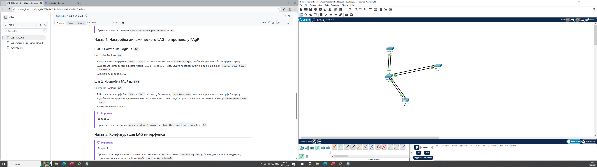
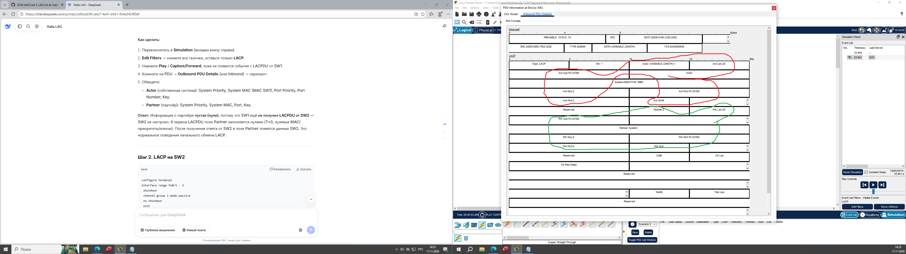

# Отчет по лабораторной работе №5
**Тема:** LAG
**Выполнил:** Гаврилов Ярослав и Жарков, гр. 539  

## Топология



## Ответы на вопросы

1. Потому что между SW1–SW2 и SW1–SW3 проложены параллельные линки, образующие петлю. Протокол STP (Spanning Tree Protocol) по умолчанию включён на 2960.
 Чтобы предотвратить широковещательный шторм, STP переводит один из портов в состояние Blocking (BLK) — он не передаёт пользовательский трафик. Кроме того,
 физические интерфейсы по умолчанию в состоянии shutdown (административно отключены), пока их не включат no shutdown. В топологии до настройки LAG часть портов
 будет в состоянии down/blocking — это нормально. После объединения в EtherChannel STP будет видеть один логический порт, и блокировка исчезнет.


2.
```text
SW1#show etherchannel summary
Flags:  D - down        P - in port-channel
        I - stand-alone s - suspended
        H - Hot-standby (LACP only)
        R - Layer3      S - Layer2
        U - in use      f - failed to allocate aggregator
        u - unsuitable for bundling
        w - waiting to be aggregated
        d - default port


Number of channel-groups in use: 1
Number of aggregators:           1

Group  Port-channel  Protocol    Ports
------+-------------+-----------+----------------------------------------------

1      Po1(SD)           -      Gig0/1(D) Gig0/2(D) 
```

```text
SW1#show etherchannel port-channel
                Channel-group listing:
                ----------------------

Group: 1
----------
                Port-channels in the group:
                ---------------------------

Port-channel: Po1
------------

Age of the Port-channel   = 00d:00h:00m:48s
Logical slot/port   = 2/1       Number of ports = 0
GC                  = 0x00000000      HotStandBy port = null
Port state          = Port-channel 
Protocol            =   PAGP
Port Security       = Disabled
```

```text
SW1#show interfaces Po1
Port-channel1 is down, line protocol is down (disabled)
  Hardware is EtherChannel, address is 0003.e4e2.7651 (bia 0003.e4e2.7651)
  MTU 1500 bytes, BW 2000000 Kbit, DLY 1000 usec,
     reliability 255/255, txload 1/255, rxload 1/255
  Encapsulation ARPA, loopback not set
  Keepalive set (10 sec)
  Half-duplex, 2000Mb/s
  input flow-control is off, output flow-control is off
  Members in this channel: 
  ARP type: ARPA, ARP Timeout 04:00:00
  Last input 00:00:08, output 00:00:05, output hang never
  Last clearing of "show interface" counters never
  Input queue: 0/75/0/0 (size/max/drops/flushes); Total output drops: 0
  Queueing strategy: fifo
  Output queue :0/40 (size/max)
  5 minute input rate 0 bits/sec, 0 packets/sec
  5 minute output rate 0 bits/sec, 0 packets/sec
     956 packets input, 193351 bytes, 0 no buffer
     Received 956 broadcasts, 0 runts, 0 giants, 0 throttles
     0 input errors, 0 CRC, 0 frame, 0 overrun, 0 ignored, 0 abort
     0 watchdog, 0 multicast, 0 pause input
     0 input packets with dribble condition detected
     2357 packets output, 263570 bytes, 0 underruns
     0 output errors, 0 collisions, 10 interface resets
     0 babbles, 0 late collision, 0 deferred
     0 lost carrier, 0 no carrier
     0 output buffer failures, 0 output buffers swapped out
```
Агрегированный канал Po1 находится в состоянии SD (S = Layer2/switched, D = down). Дочерние физические интерфейсы Gi0/1 и Gi0/2 — в состоянии D (down). В выводе show etherchannel
 port-channel видно Number of ports = 0, а в show interfaces Po1 — пустой список Members in this channel:. Это означает, что ни один физический порт фактически не стал членом агрегированного канала. 
Сам интерфейс Po1: Port-channel1 is down, line protocol is down (disabled).
Готов ли канал передавать трафик:
Нет, не готов. Канал в состоянии down, порты не забандлены (0 members), line protocol down. Признаков SU (in use) и P (bundled) нет. Трафик через Po1 сейчас не передаётся.
Может ли это вызвать проблемы, с учётом что R1 ещё не настроен:
Да, и вот почему:
Режим on не использует протокол согласования — нет LACPDU/PAgPDU, которые проверяют совместимость параметров на двух концах. Канал полагается только на то, что администратор вручную настроил обе стороны одинаково.
Если на R1 настроить несовместимый режим (active, passive, desirable, auto вместо on) — канал не поднимется (по таблице совместимости on + любой другой = ❌).
Если на R1 настроить on, но с другими параметрами портов (скорость, duplex, VLAN, native VLAN, allowed VLAN) — канал может подняться «криво» или работать нестабильно. Именно из-за отсутствия
 проверки совместимости Cisco предупреждает об осторожности с режимом on.
Риск петли — если на R1 случайно не образуется LAG, а физические линки останутся параллельными, STP может не успеть заблокировать порт, и возникнет петля/широковещательный шторм.
Пока R1 не настроен — канал просто down, трафика нет. Это безопасно, но бесполезно: полоса не используется, резервирования нет.
Вывод: состояние SD на данном этапе — ожидаемое и нормальное. Проблема не в том, что канал down, а в том, что режим on не защищает от ошибок конфигурации на другой стороне. После настройки
 R1 (тоже channel-group 1 mode on) канал должен перейти в SU, а порты — в P (bundled); это нужно проверить командами show etherchannel summary и show interfaces Po1.


3.
```text
SW1#show etherchannel summary
Flags:  D - down        P - in port-channel
        I - stand-alone s - suspended
        H - Hot-standby (LACP only)
        R - Layer3      S - Layer2
        U - in use      f - failed to allocate aggregator
        u - unsuitable for bundling
        w - waiting to be aggregated
        d - default port


Number of channel-groups in use: 2
Number of aggregators:           2

Group  Port-channel  Protocol    Ports
------+-------------+-----------+----------------------------------------------

1      Po1(SU)           -      Gig0/1(P) Gig0/2(P) 
2      Po2(SD)           LACP   Fa0/1(I) Fa0/2(I) 
```

```text
SW1#show etherchannel port-channel
                Channel-group listing:
                ----------------------

Group: 1
----------
                Port-channels in the group:
                ---------------------------

Port-channel: Po1
------------

Age of the Port-channel   = 00d:00h:09m:05s
Logical slot/port   = 2/1       Number of ports = 2
GC                  = 0x00000000      HotStandBy port = null
Port state          = Port-channel 
Protocol            =   PAGP
Port Security       = Disabled

Ports in the Port-channel:

Index   Load   Port     EC state        No of bits
------+------+------+------------------+-----------
  0     00     Gig0/1   On                 0
  0     00     Gig0/2   On                 0
Time since last port bundled:    00d:00h:01m:44s    Gig0/2
Group: 2
----------
                Port-channels in the group:
                ---------------------------

Port-channel: Po2    (Primary Aggregator)
------------

Age of the Port-channel   = 00d:00h:00m:26s
Logical slot/port   = 2/2       Number of ports = 0
GC                  = 0x00000000      HotStandBy port = null
Port state          = Port-channel 
Protocol            =   LACP
Port Security       = Disabled
```

```text
SW1# show interfaces Po2
Port-channel2 is down, line protocol is down (disabled)
  Hardware is EtherChannel, address is 0030.f28d.97e7 (bia 0030.f28d.97e7)
  MTU 1500 bytes, BW 200000 Kbit, DLY 1000 usec,
     reliability 255/255, txload 1/255, rxload 1/255
  Encapsulation ARPA, loopback not set
  Keepalive set (10 sec)
  Half-duplex, 200Mb/s
  input flow-control is off, output flow-control is off
  Members in this channel: Fa0/1 ,Fa0/2 ,
  ARP type: ARPA, ARP Timeout 04:00:00
  Last input 00:00:08, output 00:00:05, output hang never
  Last clearing of "show interface" counters never
  Input queue: 0/75/0/0 (size/max/drops/flushes); Total output drops: 0
  Queueing strategy: fifo
  Output queue :0/40 (size/max)
  5 minute input rate 0 bits/sec, 0 packets/sec
  5 minute output rate 0 bits/sec, 0 packets/sec
     956 packets input, 193351 bytes, 0 no buffer
     Received 956 broadcasts, 0 runts, 0 giants, 0 throttles
     0 input errors, 0 CRC, 0 frame, 0 overrun, 0 ignored, 0 abort
     0 watchdog, 0 multicast, 0 pause input
     0 input packets with dribble condition detected
     2357 packets output, 263570 bytes, 0 underruns
     0 output errors, 0 collisions, 10 interface resets
     0 babbles, 0 late collision, 0 deferred
     0 lost carrier, 0 no carrier
     0 output buffer failures, 0 output buffers swapped out
```
На SW1 агрегированный канал Po2 находится в состоянии SD (Switched, Down): show interfaces Po2 показывает Port-channel2 is down, line protocol
 is down (disabled), Number of ports = 0. Дочерние интерфейсы Fa0/1 и Fa0/2 находятся в состоянии I (independent) — они не объединены в канал и работают 
как отдельные порты. Канал не готов передавать трафик, поскольку вторая сторона (SW2) ещё не настроена и LACP-переговоры не завершены. После настройки SW2 в
 режиме passive канал перейдёт в SU, а порты — в P (bundled).


4. 
Информация о партнёре пустая (нули), потому что SW1 ещё не получил LACPDU от SW2 — SW2 не настроен. В первом LACPDU поле Partner заполняется нулями 
(T=0, нулевые MAC/приоритеты/ключи). После получения ответа от SW2 в поле Partner появятся данные SW2. Это нормальное поведение начального обмена LACP.



5.
Нет, не помешает. Номер channel-group / Port-channel — локальный идентификатор внутри устройства. LACP идентифицирует партнёра по System ID (приоритет + MAC), а не по номеру группы.
 На SW1 будет Po2, на SW2 — Po1, но канал согласуется успешно.

```text
SW2#show etherchannel port-channel
                Channel-group listing:
                ----------------------

Group: 1
----------
                Port-channels in the group:
                ---------------------------

Port-channel: Po1    (Primary Aggregator)
------------

Age of the Port-channel   = 00d:00h:01m:11s
Logical slot/port   = 2/1       Number of ports = 2
GC                  = 0x00000000      HotStandBy port = null
Port state          = Port-channel 
Protocol            =   LACP
Port Security       = Disabled

Ports in the Port-channel:

Index   Load   Port     EC state        No of bits
------+------+------+------------------+-----------
  0     00     Fa0/1    Passive            0
  0     00     Fa0/2    Passive            0
Time since last port bundled:    00d:00h:01m:11s    Fa0/2
```

6.

```text
SW1# show etherchannel summary
Flags:  D - down        P - in port-channel
        I - stand-alone s - suspended
        H - Hot-standby (LACP only)
        R - Layer3      S - Layer2
        U - in use      f - failed to allocate aggregator
        u - unsuitable for bundling
        w - waiting to be aggregated
        d - default port


Number of channel-groups in use: 3
Number of aggregators:           3

Group  Port-channel  Protocol    Ports
------+-------------+-----------+----------------------------------------------

1      Po1(SU)           -      Gig0/1(P) Gig0/2(P) 
2      Po2(SU)           LACP   Fa0/1(P) Fa0/2(P) 
3      Po3(SU)           PAgP   Fa0/3(P) Fa0/4(P) 
```
```text
SW1#show etherchannel port-channel
                Channel-group listing:
                ----------------------

Group: 1
----------
                Port-channels in the group:
                ---------------------------

Port-channel: Po1
------------

Age of the Port-channel   = 00d:00h:19m:22s
Logical slot/port   = 2/1       Number of ports = 2
GC                  = 0x00000000      HotStandBy port = null
Port state          = Port-channel 
Protocol            =   PAGP
Port Security       = Disabled

Ports in the Port-channel:

Index   Load   Port     EC state        No of bits
------+------+------+------------------+-----------
  0     00     Gig0/1   On                 0
  0     00     Gig0/2   On                 0
Time since last port bundled:    00d:00h:12m:02s    Gig0/2
Group: 2
----------
                Port-channels in the group:
                ---------------------------

Port-channel: Po2    (Primary Aggregator)
------------

Age of the Port-channel   = 00d:00h:10m:43s
Logical slot/port   = 2/2       Number of ports = 2
GC                  = 0x00000000      HotStandBy port = null
Port state          = Port-channel 
Protocol            =   LACP
Port Security       = Disabled

Ports in the Port-channel:

Index   Load   Port     EC state        No of bits
------+------+------+------------------+-----------
  0     00     Fa0/1    Active             0
  0     00     Fa0/2    Active             0
Time since last port bundled:    00d:00h:03m:49s    Fa0/2
Group: 3
----------
                Port-channels in the group:
                ---------------------------

Port-channel: Po3
------------

Age of the Port-channel   = 00d:00h:01m:23s
Logical slot/port   = 2/3       Number of ports = 2
GC                  = 0x00000000      HotStandBy port = null
Port state          = Port-channel 
Protocol            =   PAGP
Port Security       = Disabled

Ports in the Port-channel:

Index   Load   Port     EC state        No of bits
------+------+------+------------------+-----------
  0     00     Fa0/3    Desirable-Sl       0
  0     00     Fa0/4    Desirable-Sl       0
Time since last port bundled:    00d:00h:01m:09s    Fa0/4
```

7.

```text
interface Port-channel2
!
interface FastEthernet0/1
 channel-group 2 mode active
!
interface FastEthernet0/2
 channel-group 2 mode active
!
```

```text
interface Port-channel2
 switchport mode trunk
 switchport nonegotiate
 spanning-tree portfast trunk
!
interface FastEthernet0/1
 switchport mode trunk
 switchport nonegotiate
 channel-group 2 mode active
!
interface FastEthernet0/2
 switchport mode trunk
 switchport nonegotiate
 channel-group 2 mode active
```
Сравнение: Настройки trunk/nonegotiate/portfast применились только к логическому интерфейсу Port-channel2, а не к физическим Fa0/1, Fa0/2. Это правильно: настройки 
на Port-channel автоматически действуют на всех членов LAG. Физические порты сохраняют свои индивидуальные настройки (access), но фактически работают в составе trunk-канала
 через Port-channel. Не нужно настраивать trunk на каждом физическом порту — это частая ошибка.


9.
По умолчанию на Catalyst 2960 используется src-mac (хеш по MAC-адресу источника). Если большая часть трафика идёт от R1 ко многим 
получателям, то у всех пакетов src-MAC одинаковый (MAC роутера R1). Хеш будет одинаковым → весь трафик пойдёт по одному физическому линку, 
остальные будут простаивать. Это называется поляризацией или неравномерной балансировкой.


10.
Выбран src-dst-ip (хеш по паре IP-адресов источника и назначения). Почему:

Трафик от R1 идёт ко многим хостам с разными dst-IP → хеш будет различаться → потоки распределятся по разным линкам.

Для смешанного трафика (и от R1, и к R1) комбинация src+dst IP даёт более равномерное распределение, чем только src-mac или только dst-ip.

Универсального «лучшего» алгоритма нет — выбор зависит от профиля трафика. Для данной лабы src-dst-ip — разумный компромисс.